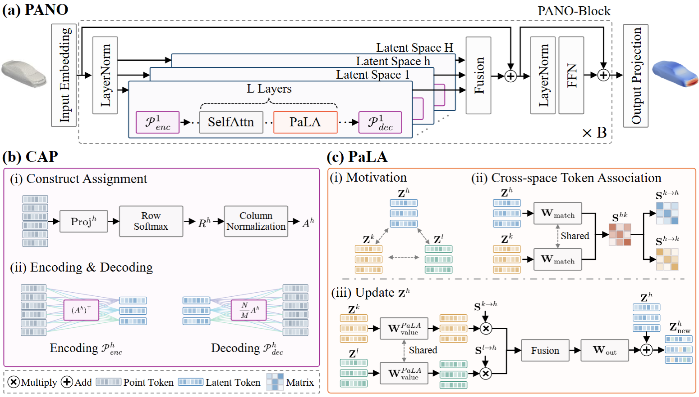

# PANO: Parallel Latent Space Neural Operator for Solving PDEs

<div align="center">

<a href=''></a>
<a href='https://github.com/ZijiangY1116/PANO'></a>
<a href='https://huggingface.co/ZijiangY/PANO'></a>

</div>

This is the official code repository for the paper "PANO: Parallel Latent Space Neural Operator for Solving PDEs".

<div  align="center">

</div>

Aggregating observations into a limited number of latent tokens and learning physical interactions in the latent space has emerged as an effective approach for Transformer-based neural operators to solve Partial Differential Equation (PDE) problems involving large-scale observations. However, existing methods typically compress observations using a single aggregation pattern, making physical information not retained by that pattern invisible to the latent space and thereby constraining physical interactions within it. To address this limitation, we propose **PA**rallel Latent Space **N**eural **O**perator (**PANO**), a novel neural operator for solving PDEs that formulates physical interactions among observations as an additive combination of interaction results from parallel latent spaces with shared parameters. Specifically, PANO transforms observations into multiple distinct compressed representations through independent mappings, learns physical interactions in parallel based on these representations, and finally fuses the decoded results to predict the target physical field. Within PANO, we further propose **C**oupled **A**ssignment **P**rojection (**CAP**) to construct bidirectionally consistent encoding and decoding mappings, and **Pa**irwise **L**atent Space **A**ttention Layer (**PaLA**) to jointly update latent representations of each latent space through adaptive cross-space interactions. Extensive experiments on nine benchmarks spanning diverse physical systems, geometries, and observation scales demonstrate that PANO achieves state-of-the-art performance. Notably, PANO reduces equivalent plastic strain prediction errors on Unilateral Stamping by 28.3% (or more) and lift-coefficient prediction errors on AirCraft by 21.4% (or more) compared with existing methods.

## Environment Setup

```bash
conda create --name PANO python=3.10
conda activate PANO
pip install torch==2.8.0 torchvision==0.23.0 torchaudio==2.8.0
pip install -r requirements.txt
```

## Data Preparation

Please download the raw datasets from their original sources. Preprocessing writes to `./dataset` by default.

| Dataset | Raw data source | Introduction |
| --- | --- | --- |
| Airfoil | [Airfoil](https://drive.google.com/drive/folders/1YBuaoTdOSr_qzaow-G-iwvbUI7fiUzu8) | [Geo-FNO](https://github.com/neuraloperator/Geo-FNO) |
| Plasticity | [Plasticity](https://drive.google.com/drive/folders/1YBuaoTdOSr_qzaow-G-iwvbUI7fiUzu8) | [Geo-FNO](https://github.com/neuraloperator/Geo-FNO) |
| NS2d | [NS2d](https://drive.google.com/drive/folders/1UnbQh2WWc6knEHbLn-ZaXrKUZhp7pjt-) | [FNO](https://github.com/li-Pingan/fourier-neural-operator) |
| Elasticity | [Elasticity](https://drive.google.com/drive/folders/1YBuaoTdOSr_qzaow-G-iwvbUI7fiUzu8) | [Geo-FNO](https://github.com/neuraloperator/Geo-FNO) |
| Darcy | [Darcy](https://drive.google.com/drive/folders/1UnbQh2WWc6knEHbLn-ZaXrKUZhp7pjt-) | [FNO](https://github.com/li-Pingan/fourier-neural-operator) |
| AirfRANS | [AirfRANS](https://data.isir.upmc.fr/extrality/NeurIPS_2022/Dataset.zip) | [AirfRANS](https://github.com/Extrality/AirfRANS) |
| Unilateral Stamping | [Unilateral Stamping](https://disk.pku.edu.cn/link/AA70C3D42902954D1798DCD62CD4DB3C79) | [Unisoma](https://github.com/therontau0054/Unisoma) |
| ShapeNetCar | [ShapeNetCar](http://www.nobuyuki-umetani.com/publication/mlcfd_data.zip) | [Transolver (ShapeNetCar)](https://github.com/thuml/Transolver/tree/main/Car-Design-ShapeNetCar) |
| Aircraft | [Aircraft](https://drive.google.com/file/d/1UDGgtOM8UYBFbDe_t2FP7Ij9N5SA3w-g/view) | [Transolver++](https://github.com/thuml/Transolver_plus#get-started-from-aircraft-dataset) |

### Airfoil

The input directory should contain `naca/NACA_Cylinder_Q.npy`, `naca/NACA_Cylinder_X.npy`, and `naca/NACA_Cylinder_Y.npy`.

```bash
python preprocess/prepare_airfoil.py --input_dir /path/to/Airfoil
```

### Darcy

Prepare each of the three supported resolutions:

```bash
for resolution in 85 141 211; do
    python preprocess/prepare_darcy.py \
        --input_paths /path/to/piececonst_r421_N1024_smooth1.mat /path/to/piececonst_r421_N1024_smooth2.mat \
        --obj_res "$resolution"
done
```

This creates `darcy_85`, `darcy_141`, and `darcy_211` under `./dataset`.

### Elasticity

The input directory should contain the raw `Meshes` directory.

```bash
python preprocess/prepare_elasticity.py --input_dir /path/to/Elasticity
```

### Plasticity

```bash
python preprocess/prepare_plasticity.py --input_path /path/to/plas_N987_T20.mat
```

### NS2d

```bash
python preprocess/prepare_ns2d.py --input_path /path/to/NavierStokes_V1e-5_N1200_T20.mat
```

### AirfRANS

```bash
python preprocess/prepare_airfrans.py --input_dir /path/to/AirfRANS/Dataset --tasks full reynolds aoa
```

This command prepares `airfrans_full`, `airfrans_reynolds`, and `airfrans_aoa`.

For reproducible evaluation, download the prepared evaluation sampling sequences for the standard and OOD experiments from [AirfRANS (full)](https://huggingface.co/ZijiangY/PANO/blob/main/dataset/airfrans_full.zip), [AirfRANS (reynolds)](https://huggingface.co/ZijiangY/PANO/blob/main/dataset/airfrans_reynolds.zip), and [AirfRANS (aoa)](https://huggingface.co/ZijiangY/PANO/blob/main/dataset/airfrans_aoa.zip). Alternatively, you can use `preprocess/prepare_airfrans_eval_sampling.py` to generate the AirfRANS evaluation sampling sequences locally.

```bash
python preprocess/prepare_airfrans_eval_sampling.py --tasks full reynolds aoa --subsamplings 32000
```

In addition, `--airfrans_raw_root /path/to/AirfRANS/Dataset` is required for the aerodynamic coefficient evaluation. The default raw dataset root is `./raw_datasets/AirfRANS`.

### Unilateral Stamping

Use the downloaded `Unisoma_Dataset.zip` directly. The converter preserves its train/eval/test splits and computes normalization statistics from the training split.

```bash
python preprocess/prepare_stamping.py \
    --source /path/to/Unisoma_Dataset.zip \
    --output ./dataset/unilateral_stamping
```

### ShapeNetCar

```bash
python preprocess/prepare_shapenetcar.py --input_dir /path/to/ShapeNetCar --folds 0
```

The prepared dataset is `./dataset/shapenetcar_fold0`.
`--shapenetcar_raw_root /path/to/ShapeNetCar/training_data` is required for evaluation. The default raw dataset root is `./raw_datasets/ShapeNetCar/training_data`.

### Aircraft

```bash
python preprocess/prepare_aircraft.py --input_dir /path/to/aircraft --output_dir ./dataset
python preprocess/prepare_aircraft_split.py --input_dir ./dataset/aircraft
```

## Pretrained Models and Results

The pretrained models of PANO are available at [PANO (HuggingFace)](https://huggingface.co/ZijiangY/PANO).

### Standard Benchmarks

<table>
    <thead>
        <tr>
            <th style="text-align: center; vertical-align: middle;">Benchmark</th>
            <th style="text-align: center; vertical-align: middle;">Model</th>
            <th style="text-align: center; vertical-align: middle;">Weight Link</th>
            <th style="text-align: center; vertical-align: middle;">Log Link</th>
            <th style="text-align: center; vertical-align: middle;">Relative L2 &darr;</th>
        </tr>
    </thead>
    <tbody>
        <tr>
            <td rowspan="2" style="text-align: center; vertical-align: middle;">Airfoil</td>
            <td style="text-align: center;">PANO-P</td>
            <td style="text-align: center;"><a href="https://huggingface.co/ZijiangY/PANO/blob/main/pretrained/PANO-P/airfoil/checkpoint/last.pt">Download</a></td>
            <td style="text-align: center;"><a href="https://huggingface.co/ZijiangY/PANO/blob/main/pretrained/PANO-P/airfoil/log/log.txt">Download</a></td>
            <td style="text-align: center;">0.0044</td>
        </tr>
        <tr>
            <td style="text-align: center;">PANO-D</td>
            <td style="text-align: center;"><a href="https://huggingface.co/ZijiangY/PANO/blob/main/pretrained/PANO-D/airfoil/checkpoint/last.pt">Download</a></td>
            <td style="text-align: center;"><a href="https://huggingface.co/ZijiangY/PANO/blob/main/pretrained/PANO-D/airfoil/log/log.txt">Download</a></td>
            <td style="text-align: center;">0.0044</td>
        </tr>
        <tr>
            <td rowspan="2" style="text-align: center; vertical-align: middle;">Plasticity</td>
            <td style="text-align: center;">PANO-P</td>
            <td style="text-align: center;"><a href="https://huggingface.co/ZijiangY/PANO/blob/main/pretrained/PANO-P/plasticity/checkpoint/last.pt">Download</a></td>
            <td style="text-align: center;"><a href="https://huggingface.co/ZijiangY/PANO/blob/main/pretrained/PANO-P/plasticity/log/log.txt">Download</a></td>
            <td style="text-align: center;">0.0006</td>
        </tr>
        <tr>
            <td style="text-align: center;">PANO-D</td>
            <td style="text-align: center;"><a href="https://huggingface.co/ZijiangY/PANO/blob/main/pretrained/PANO-D/plasticity/checkpoint/last.pt">Download</a></td>
            <td style="text-align: center;"><a href="https://huggingface.co/ZijiangY/PANO/blob/main/pretrained/PANO-D/plasticity/log/log.txt">Download</a></td>
            <td style="text-align: center;">0.0004</td>
        </tr>
        <tr>
            <td rowspan="2" style="text-align: center; vertical-align: middle;">NS2D</td>
            <td style="text-align: center;">PANO-P</td>
            <td style="text-align: center;"><a href="https://huggingface.co/ZijiangY/PANO/blob/main/pretrained/PANO-P/ns2d/checkpoint/last.pt">Download</a></td>
            <td style="text-align: center;"><a href="https://huggingface.co/ZijiangY/PANO/blob/main/pretrained/PANO-P/ns2d/log/log.txt">Download</a></td>
            <td style="text-align: center;">0.0720</td>
        </tr>
        <tr>
            <td style="text-align: center;">PANO-D</td>
            <td style="text-align: center;"><a href="https://huggingface.co/ZijiangY/PANO/blob/main/pretrained/PANO-D/ns2d/checkpoint/last.pt">Download</a></td>
            <td style="text-align: center;"><a href="https://huggingface.co/ZijiangY/PANO/blob/main/pretrained/PANO-D/ns2d/log/log.txt">Download</a></td>
            <td style="text-align: center;">0.0395</td>
        </tr>
        <tr>
            <td rowspan="2" style="text-align: center; vertical-align: middle;">Elasticity</td>
            <td style="text-align: center;">PANO-P</td>
            <td style="text-align: center;"><a href="https://huggingface.co/ZijiangY/PANO/blob/main/pretrained/PANO-P/elasticity/checkpoint/last.pt">Download</a></td>
            <td style="text-align: center;"><a href="https://huggingface.co/ZijiangY/PANO/blob/main/pretrained/PANO-P/elasticity/log/log.txt">Download</a></td>
            <td style="text-align: center;">0.0040</td>
        </tr>
        <tr>
            <td style="text-align: center;">PANO-D</td>
            <td style="text-align: center;"><a href="https://huggingface.co/ZijiangY/PANO/blob/main/pretrained/PANO-D/elasticity/checkpoint/last.pt">Download</a></td>
            <td style="text-align: center;"><a href="https://huggingface.co/ZijiangY/PANO/blob/main/pretrained/PANO-D/elasticity/log/log.txt">Download</a></td>
            <td style="text-align: center;">0.0029</td>
        </tr>
    </tbody>
</table>

### Evaluation at Multiple Resolutions

<table>
    <thead>
        <tr>
            <th style="text-align: center; vertical-align: middle;">Benchmark</th>
            <th style="text-align: center; vertical-align: middle;">Model</th>
            <th style="text-align: center; vertical-align: middle;">Weight Link</th>
            <th style="text-align: center; vertical-align: middle;">Log Link</th>
            <th style="text-align: center; vertical-align: middle;">Relative L2 &darr;</th>
        </tr>
    </thead>
    <tbody>
        <tr>
            <td rowspan="2" style="text-align: center; vertical-align: middle;">Darcy 85&times;85</td>
            <td style="text-align: center;">PANO-P</td>
            <td style="text-align: center;"><a href="https://huggingface.co/ZijiangY/PANO/blob/main/pretrained/PANO-P/darcy85/checkpoint/last.pt">Download</a></td>
            <td style="text-align: center;"><a href="https://huggingface.co/ZijiangY/PANO/blob/main/pretrained/PANO-P/darcy85/log/log.txt">Download</a></td>
            <td style="text-align: center;">0.0055</td>
        </tr>
        <tr>
            <td style="text-align: center;">PANO-D</td>
            <td style="text-align: center;"><a href="https://huggingface.co/ZijiangY/PANO/blob/main/pretrained/PANO-D/darcy85/checkpoint/last.pt">Download</a></td>
            <td style="text-align: center;"><a href="https://huggingface.co/ZijiangY/PANO/blob/main/pretrained/PANO-D/darcy85/log/log.txt">Download</a></td>
            <td style="text-align: center;">0.0050</td>
        </tr>
        <tr>
            <td rowspan="2" style="text-align: center; vertical-align: middle;">Darcy 141&times;141</td>
            <td style="text-align: center;">PANO-P</td>
            <td style="text-align: center;"><a href="https://huggingface.co/ZijiangY/PANO/blob/main/pretrained/PANO-P/darcy141/checkpoint/last.pt">Download</a></td>
            <td style="text-align: center;"><a href="https://huggingface.co/ZijiangY/PANO/blob/main/pretrained/PANO-P/darcy141/log/log.txt">Download</a></td>
            <td style="text-align: center;">0.0042</td>
        </tr>
        <tr>
            <td style="text-align: center;">PANO-D</td>
            <td style="text-align: center;"><a href="https://huggingface.co/ZijiangY/PANO/blob/main/pretrained/PANO-D/darcy141/checkpoint/last.pt">Download</a></td>
            <td style="text-align: center;"><a href="https://huggingface.co/ZijiangY/PANO/blob/main/pretrained/PANO-D/darcy141/log/log.txt">Download</a></td>
            <td style="text-align: center;">0.0039</td>
        </tr>
        <tr>
            <td rowspan="2" style="text-align: center; vertical-align: middle;">Darcy 211&times;211</td>
            <td style="text-align: center;">PANO-P</td>
            <td style="text-align: center;"><a href="https://huggingface.co/ZijiangY/PANO/blob/main/pretrained/PANO-P/darcy211/checkpoint/last.pt">Download</a></td>
            <td style="text-align: center;"><a href="https://huggingface.co/ZijiangY/PANO/blob/main/pretrained/PANO-P/darcy211/log/log.txt">Download</a></td>
            <td style="text-align: center;">0.0041</td>
        </tr>
        <tr>
            <td style="text-align: center;">PANO-D</td>
            <td style="text-align: center;"><a href="https://huggingface.co/ZijiangY/PANO/blob/main/pretrained/PANO-D/darcy211/checkpoint/last.pt">Download</a></td>
            <td style="text-align: center;"><a href="https://huggingface.co/ZijiangY/PANO/blob/main/pretrained/PANO-D/darcy211/log/log.txt">Download</a></td>
            <td style="text-align: center;">0.0039</td>
        </tr>
    </tbody>
</table>

### AirfRANS

<table>
    <thead>
        <tr>
            <th style="text-align: center; vertical-align: middle;">Benchmark</th>
            <th style="text-align: center; vertical-align: middle;">Model</th>
            <th style="text-align: center; vertical-align: middle;">Weight Link</th>
            <th style="text-align: center; vertical-align: middle;">Log Link</th>
            <th style="text-align: center; vertical-align: middle;">Vol. &darr;</th>
            <th style="text-align: center; vertical-align: middle;">Surf. &darr;</th>
            <th style="text-align: center; vertical-align: middle;">C<sub>L</sub> &darr;</th>
            <th style="text-align: center; vertical-align: middle;">&rho;<sub>L</sub> &uarr;</th>
        </tr>
    </thead>
    <tbody>
        <tr>
            <td rowspan="2" style="text-align: center; vertical-align: middle;">AirfRANS (Full)</td>
            <td style="text-align: center;">PANO-P</td>
            <td style="text-align: center;"><a href="https://huggingface.co/ZijiangY/PANO/blob/main/pretrained/PANO-P/airfrans_full/checkpoint/last.pt">Download</a></td>
            <td style="text-align: center;"><a href="https://huggingface.co/ZijiangY/PANO/blob/main/pretrained/PANO-P/airfrans_full/log/log.txt">Download</a></td>
            <td style="text-align: center;">0.0005</td>
            <td style="text-align: center;">0.0010</td>
            <td style="text-align: center;">0.0236</td>
            <td style="text-align: center;">0.9997</td>
        </tr>
        <tr>
            <td style="text-align: center;">PANO-D</td>
            <td style="text-align: center;"><a href="https://huggingface.co/ZijiangY/PANO/blob/main/pretrained/PANO-D/airfrans_full/checkpoint/last.pt">Download</a></td>
            <td style="text-align: center;"><a href="https://huggingface.co/ZijiangY/PANO/blob/main/pretrained/PANO-D/airfrans_full/log/log.txt">Download</a></td>
            <td style="text-align: center;">0.0009</td>
            <td style="text-align: center;">0.0031</td>
            <td style="text-align: center;">0.0225</td>
            <td style="text-align: center;">0.9997</td>
        </tr>
        <tr>
            <td rowspan="2" style="text-align: center; vertical-align: middle;">OOD Reynolds</td>
            <td style="text-align: center;">PANO-P</td>
            <td style="text-align: center;"><a href="https://huggingface.co/ZijiangY/PANO/blob/main/pretrained/PANO-P/airfrans_reynolds/checkpoint/last.pt">Download</a></td>
            <td style="text-align: center;"><a href="https://huggingface.co/ZijiangY/PANO/blob/main/pretrained/PANO-P/airfrans_reynolds/log/log.txt">Download</a></td>
            <td style="text-align: center;">0.0113</td>
            <td style="text-align: center;">0.0296</td>
            <td style="text-align: center;">0.1314</td>
            <td style="text-align: center;">0.9970</td>
        </tr>
        <tr>
            <td style="text-align: center;">PANO-D</td>
            <td style="text-align: center;"><a href="https://huggingface.co/ZijiangY/PANO/blob/main/pretrained/PANO-D/airfrans_reynolds/checkpoint/last.pt">Download</a></td>
            <td style="text-align: center;"><a href="https://huggingface.co/ZijiangY/PANO/blob/main/pretrained/PANO-D/airfrans_reynolds/log/log.txt">Download</a></td>
            <td style="text-align: center;">0.0106</td>
            <td style="text-align: center;">0.0462</td>
            <td style="text-align: center;">0.0834</td>
            <td style="text-align: center;">0.9985</td>
        </tr>
        <tr>
            <td rowspan="2" style="text-align: center; vertical-align: middle;">OOD Angles</td>
            <td style="text-align: center;">PANO-P</td>
            <td style="text-align: center;"><a href="https://huggingface.co/ZijiangY/PANO/blob/main/pretrained/PANO-P/airfrans_angles/checkpoint/last.pt">Download</a></td>
            <td style="text-align: center;"><a href="https://huggingface.co/ZijiangY/PANO/blob/main/pretrained/PANO-P/airfrans_angles/log/log.txt">Download</a></td>
            <td style="text-align: center;">0.0261</td>
            <td style="text-align: center;">0.1709</td>
            <td style="text-align: center;">0.0671</td>
            <td style="text-align: center;">0.9977</td>
        </tr>
        <tr>
            <td style="text-align: center;">PANO-D</td>
            <td style="text-align: center;"><a href="https://huggingface.co/ZijiangY/PANO/blob/main/pretrained/PANO-D/airfrans_angles/checkpoint/last.pt">Download</a></td>
            <td style="text-align: center;"><a href="https://huggingface.co/ZijiangY/PANO/blob/main/pretrained/PANO-D/airfrans_angles/log/log.txt">Download</a></td>
            <td style="text-align: center;">0.0362</td>
            <td style="text-align: center;">0.1823</td>
            <td style="text-align: center;">0.0658</td>
            <td style="text-align: center;">0.9980</td>
        </tr>
    </tbody>
</table>

### Unilateral Stamping

#### Metal

<table>
    <thead>
        <tr>
            <th style="text-align: center; vertical-align: middle;">Benchmark</th>
            <th style="text-align: center; vertical-align: middle;">Model</th>
            <th style="text-align: center; vertical-align: middle;">Weight Link</th>
            <th style="text-align: center; vertical-align: middle;">Log Link</th>
            <th style="text-align: center; vertical-align: middle;">Geometry &darr;</th>
            <th style="text-align: center; vertical-align: middle;">Stress &darr;</th>
            <th style="text-align: center; vertical-align: middle;">PEEQ &darr;</th>
        </tr>
    </thead>
    <tbody>
        <tr>
            <td rowspan="2" style="text-align: center; vertical-align: middle;">Unilateral Stamping</td>
            <td style="text-align: center;">PANO-P</td>
            <td style="text-align: center;"><a href="https://huggingface.co/ZijiangY/PANO/blob/main/pretrained/PANO-P/unilateral_stamping/checkpoint/last.pt">Download</a></td>
            <td style="text-align: center;"><a href="https://huggingface.co/ZijiangY/PANO/blob/main/pretrained/PANO-P/unilateral_stamping/log/log.txt">Download</a></td>
            <td style="text-align: center;">0.0052</td>
            <td style="text-align: center;">0.0743</td>
            <td style="text-align: center;">0.1827</td>
        </tr>
        <tr>
            <td style="text-align: center;">PANO-D</td>
            <td style="text-align: center;"><a href="https://huggingface.co/ZijiangY/PANO/blob/main/pretrained/PANO-D/unilateral_stamping/checkpoint/last.pt">Download</a></td>
            <td style="text-align: center;"><a href="https://huggingface.co/ZijiangY/PANO/blob/main/pretrained/PANO-D/unilateral_stamping/log/log.txt">Download</a></td>
            <td style="text-align: center;">0.0067</td>
            <td style="text-align: center;">0.0756</td>
            <td style="text-align: center;">0.2248</td>
        </tr>
    </tbody>
</table>

#### Rubber

<table>
    <thead>
        <tr>
            <th style="text-align: center; vertical-align: middle;">Benchmark</th>
            <th style="text-align: center; vertical-align: middle;">Model</th>
            <th style="text-align: center; vertical-align: middle;">Weight Link</th>
            <th style="text-align: center; vertical-align: middle;">Log Link</th>
            <th style="text-align: center; vertical-align: middle;">Geometry &darr;</th>
            <th style="text-align: center; vertical-align: middle;">Stress &darr;</th>
            <th style="text-align: center; vertical-align: middle;">PEEQ &darr;</th>
        </tr>
    </thead>
    <tbody>
        <tr>
            <td rowspan="2" style="text-align: center; vertical-align: middle;">Unilateral Stamping</td>
            <td style="text-align: center;">PANO-P</td>
            <td style="text-align: center;"><a href="https://huggingface.co/ZijiangY/PANO/blob/main/pretrained/PANO-P/unilateral_stamping/checkpoint/last.pt">Download</a></td>
            <td style="text-align: center;"><a href="https://huggingface.co/ZijiangY/PANO/blob/main/pretrained/PANO-P/unilateral_stamping/log/log.txt">Download</a></td>
            <td style="text-align: center;">0.0044</td>
            <td style="text-align: center;">0.0667</td>
            <td style="text-align: center;">0.1515</td>
        </tr>
        <tr>
            <td style="text-align: center;">PANO-D</td>
            <td style="text-align: center;"><a href="https://huggingface.co/ZijiangY/PANO/blob/main/pretrained/PANO-D/unilateral_stamping/checkpoint/last.pt">Download</a></td>
            <td style="text-align: center;"><a href="https://huggingface.co/ZijiangY/PANO/blob/main/pretrained/PANO-D/unilateral_stamping/log/log.txt">Download</a></td>
            <td style="text-align: center;">0.0058</td>
            <td style="text-align: center;">0.0710</td>
            <td style="text-align: center;">0.1822</td>
        </tr>
    </tbody>
</table>

### ShapeNetCar

<table>
    <thead>
        <tr>
            <th style="text-align: center; vertical-align: middle;">Benchmark</th>
            <th style="text-align: center; vertical-align: middle;">Model</th>
            <th style="text-align: center; vertical-align: middle;">Weight Link</th>
            <th style="text-align: center; vertical-align: middle;">Log Link</th>
            <th style="text-align: center; vertical-align: middle;">Vol. &darr;</th>
            <th style="text-align: center; vertical-align: middle;">Surf. &darr;</th>
            <th style="text-align: center; vertical-align: middle;">C<sub>D</sub> &darr;</th>
            <th style="text-align: center; vertical-align: middle;">&rho;<sub>D</sub> &uarr;</th>
        </tr>
    </thead>
    <tbody>
        <tr>
            <td rowspan="2" style="text-align: center; vertical-align: middle;">ShapeNetCar</td>
            <td style="text-align: center;">PANO-P</td>
            <td style="text-align: center;"><a href="https://huggingface.co/ZijiangY/PANO/blob/main/pretrained/PANO-P/shapenetcar/checkpoint/last.pt">Download</a></td>
            <td style="text-align: center;"><a href="https://huggingface.co/ZijiangY/PANO/blob/main/pretrained/PANO-P/shapenetcar/log/log.txt">Download</a></td>
            <td style="text-align: center;">0.0214</td>
            <td style="text-align: center;">0.0817</td>
            <td style="text-align: center;">0.0126</td>
            <td style="text-align: center;">0.9874</td>
        </tr>
        <tr>
            <td style="text-align: center;">PANO-D</td>
            <td style="text-align: center;"><a href="https://huggingface.co/ZijiangY/PANO/blob/main/pretrained/PANO-D/shapenetcar/checkpoint/last.pt">Download</a></td>
            <td style="text-align: center;"><a href="https://huggingface.co/ZijiangY/PANO/blob/main/pretrained/PANO-D/shapenetcar/log/log.txt">Download</a></td>
            <td style="text-align: center;">0.0187</td>
            <td style="text-align: center;">0.0784</td>
            <td style="text-align: center;">0.0117</td>
            <td style="text-align: center;">0.9917</td>
        </tr>
    </tbody>
</table>

### Aircraft

<table>
    <thead>
        <tr>
            <th style="text-align: center; vertical-align: middle;">Benchmark</th>
            <th style="text-align: center; vertical-align: middle;">Model</th>
            <th style="text-align: center; vertical-align: middle;">Weight Link</th>
            <th style="text-align: center; vertical-align: middle;">Log Link</th>
            <th style="text-align: center; vertical-align: middle;">Surf. &darr;</th>
            <th style="text-align: center; vertical-align: middle;">C<sub>L</sub> &darr;</th>
            <th style="text-align: center; vertical-align: middle;">R<sub>L</sub><sup>2</sup> &uarr;</th>
        </tr>
    </thead>
    <tbody>
        <tr>
            <td rowspan="2" style="text-align: center; vertical-align: middle;">Aircraft</td>
            <td style="text-align: center;">PANO-P</td>
            <td style="text-align: center;"><a href="https://huggingface.co/ZijiangY/PANO/blob/main/pretrained/PANO-P/aircraft/checkpoint/last.pt">Download</a></td>
            <td style="text-align: center;"><a href="https://huggingface.co/ZijiangY/PANO/blob/main/pretrained/PANO-P/aircraft/log/log.txt">Download</a></td>
            <td style="text-align: center;">0.063</td>
            <td style="text-align: center;">0.016</td>
            <td style="text-align: center;">1.000 (0.9995)</td>
        </tr>
        <tr>
            <td style="text-align: center;">PANO-D</td>
            <td style="text-align: center;"><a href="https://huggingface.co/ZijiangY/PANO/blob/main/pretrained/PANO-D/aircraft/checkpoint/last.pt">Download</a></td>
            <td style="text-align: center;"><a href="https://huggingface.co/ZijiangY/PANO/blob/main/pretrained/PANO-D/aircraft/log/log.txt">Download</a></td>
            <td style="text-align: center;">0.056</td>
            <td style="text-align: center;">0.011</td>
            <td style="text-align: center;">1.000 (0.9997)</td>
        </tr>
    </tbody>
</table>

## Quick Start

### Training

To reproduce the results of PANO-P and PANO-D, launch training with:

```bash
python exp.py --config %CONFIG_FILE
```

where `%CONFIG_FILE` is the path to the YAML configuration for the selected model and benchmark. The experiment configurations are stored in `./conf`, as listed below.

| Benchmark | PANO-P | PANO-D |
| --- | --- | --- |
| Airfoil | [pano-p_airfoil.yaml](./conf/pano-p_airfoil.yaml) | [pano-d_airfoil.yaml](./conf/pano-d_airfoil.yaml) |
| Plasticity | [pano-p_plasticity.yaml](./conf/pano-p_plasticity.yaml) | [pano-d_plasticity.yaml](./conf/pano-d_plasticity.yaml) |
| NS2D | [pano-p_ns2d.yaml](./conf/pano-p_ns2d.yaml) | [pano-d_ns2d.yaml](./conf/pano-d_ns2d.yaml) |
| Elasticity | [pano-p_elasticity.yaml](./conf/pano-p_elasticity.yaml) | [pano-d_elasticity.yaml](./conf/pano-d_elasticity.yaml) |
| Darcy85 | [pano-p_darcy_85.yaml](./conf/pano-p_darcy_85.yaml) | [pano-d_darcy_85.yaml](./conf/pano-d_darcy_85.yaml) |
| Darcy141 | [pano-p_darcy_141.yaml](./conf/pano-p_darcy_141.yaml) | [pano-d_darcy_141.yaml](./conf/pano-d_darcy_141.yaml) |
| Darcy211 | [pano-p_darcy_211.yaml](./conf/pano-p_darcy_211.yaml) | [pano-d_darcy_211.yaml](./conf/pano-d_darcy_211.yaml) |
| AirfRANS (full) | [pano-p_airfrans_full.yaml](./conf/pano-p_airfrans_full.yaml) | [pano-d_airfrans_full.yaml](./conf/pano-d_airfrans_full.yaml) |
| AirfRANS (OOD Reynolds) | [pano-p_airfrans_reynolds.yaml](./conf/pano-p_airfrans_reynolds.yaml) | [pano-d_airfrans_reynolds.yaml](./conf/pano-d_airfrans_reynolds.yaml) |
| AirfRANS (OOD Angles) | [pano-p_airfrans_aoa.yaml](./conf/pano-p_airfrans_aoa.yaml) | [pano-d_airfrans_aoa.yaml](./conf/pano-d_airfrans_aoa.yaml) |
| Unilateral Stamping | [pano-p_unilateral_stamping.yaml](./conf/pano-p_unilateral_stamping.yaml) | [pano-d_unilateral_stamping.yaml](./conf/pano-d_unilateral_stamping.yaml) |
| ShapeNetCar | [pano-p_shapenetcar.yaml](./conf/pano-p_shapenetcar.yaml) | [pano-d_shapenetcar.yaml](./conf/pano-d_shapenetcar.yaml) |
| Aircraft | [pano-p_aircraft.yaml](./conf/pano-p_aircraft.yaml) | [pano-d_aircraft.yaml](./conf/pano-d_aircraft.yaml) |

Training records, TensorBoard logs, checkpoints, saved arguments, and final evaluation metrics are written under `./outputs/<timestamp>_<experiment-name>/`.

### Evaluation

After training, `exp.py` automatically runs evaluation using the **latest** checkpoint. We do not perform any model selection. You can also evaluate a saved experiment independently with:

```bash
python eval.py --exp_folder %EXP_FOLDER
```

where `%EXP_FOLDER` is the experiment directory name under `./outputs` or the path to an experiment directory containing `para/config.json` and model weights in `checkpoint/`.

By default, evaluation uses the test split and the latest numeric checkpoint. A specific epoch can instead be evaluated with `--checkpoint_epoch`. If an experiment contains no numeric checkpoint but provides `checkpoint/last.pt`, `eval.py` loads `last.pt` automatically. Evaluation metrics are saved to `<experiment>/test/res.json`. Use `--output_dir /path/to/evaluation` to save results in a separate directory.

## License

The code and pretrained models is released under the [Apache 2.0 license](./LICENSE).
